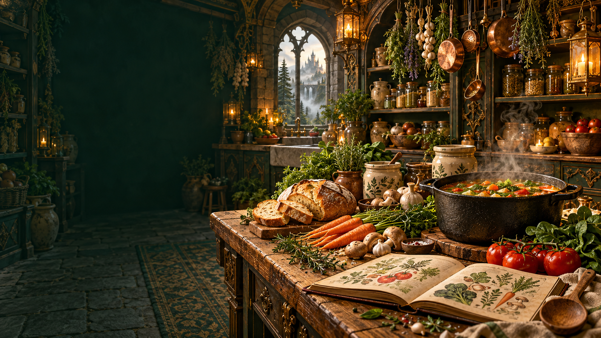

  

# MealTale

### The Enchanted Kitchen

**A little magic. A better kitchen.**

Your pantry, recipes, shopping lists, and weekly meals—all in one magical kingdom.

**[Explore MealTale →](https://mealtale.vercel.app)**

_Good food. Less waste. Everyday magic._

## Your Kitchen Kingdom

Become the **Kitchen Keeper**: organize your ingredients, discover meals you can cook, and make the most of what you already have.

- **Royal Vault** — Manage pantry ingredients, quantities, storage, and expiry dates.
- **Ancient Cookbook** — Discover recipes using your pantry, save favorites, and track cooked meals.
- **Market Quests** — Create shopping lists and add missing recipe ingredients.
- **Royal Feast** — Plan breakfast, lunch, and dinner for the week.
- **Freshness Guardian** — Get in-app alerts for ingredients nearing expiry.
- **Kingdom Ledger** — Review pantry activity, consumption, and recorded food waste.
- **Your Own Kingdom** — Register, sign in, and keep your kitchen data in your account.

## The Journey

**Sign in → Stock your vault → Discover recipes → Shop what’s missing → Plan and cook → Track your kitchen.**

## Demo Accounts

All three accounts use **`Keeper@12345`**:

- **Rowan Greenleaf:** `rowan@demo.mealtale.local`
- **Willow Hearthwood:** `willow@demo.mealtale.local`
- **Ember Ashford:** `ember@demo.mealtale.local`

Newly seeded accounts include 12 pantry ingredients, eight shared recipes, two favorites, a shopping list, and a meal plan. These logins work where demo seeding is enabled and share editable sample data.

For a fresh sample kitchen, choose **Explore a private demo kingdom** on the login page.

---

**Collect thoughtfully. Cook creatively. Waste a little less.**

[Enter your kingdom](https://mealtale.vercel.app)

